

# ResumeCraft AI

**AI-assisted resume builder with a live PDF preview, four ATS-friendly templates, bring-your-own-key AI and full Arabic (RTL) support.**

[**Live demo**](https://resume.everbuild.cloud) · [**Portfolio**](https://portfolio.everbuild.cloud) · [**LinkedIn**](https://linkedin.com/in/dafallah-ibrahim)

> [!NOTE]
> This is a showcase repository. The source code is private (personal project). It documents what the product does, how it's built and my role. Happy to walk through the code in an interview.

  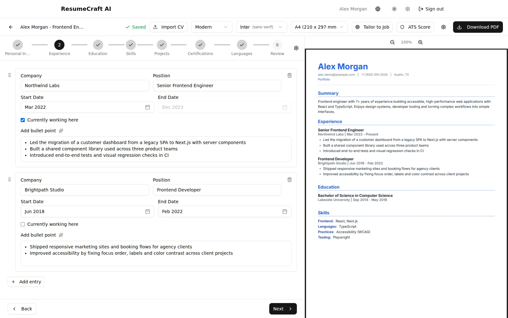

All screenshots are real captures of the live app, using a made-up demo persona ("Alex Morgan").

## Screenshots

  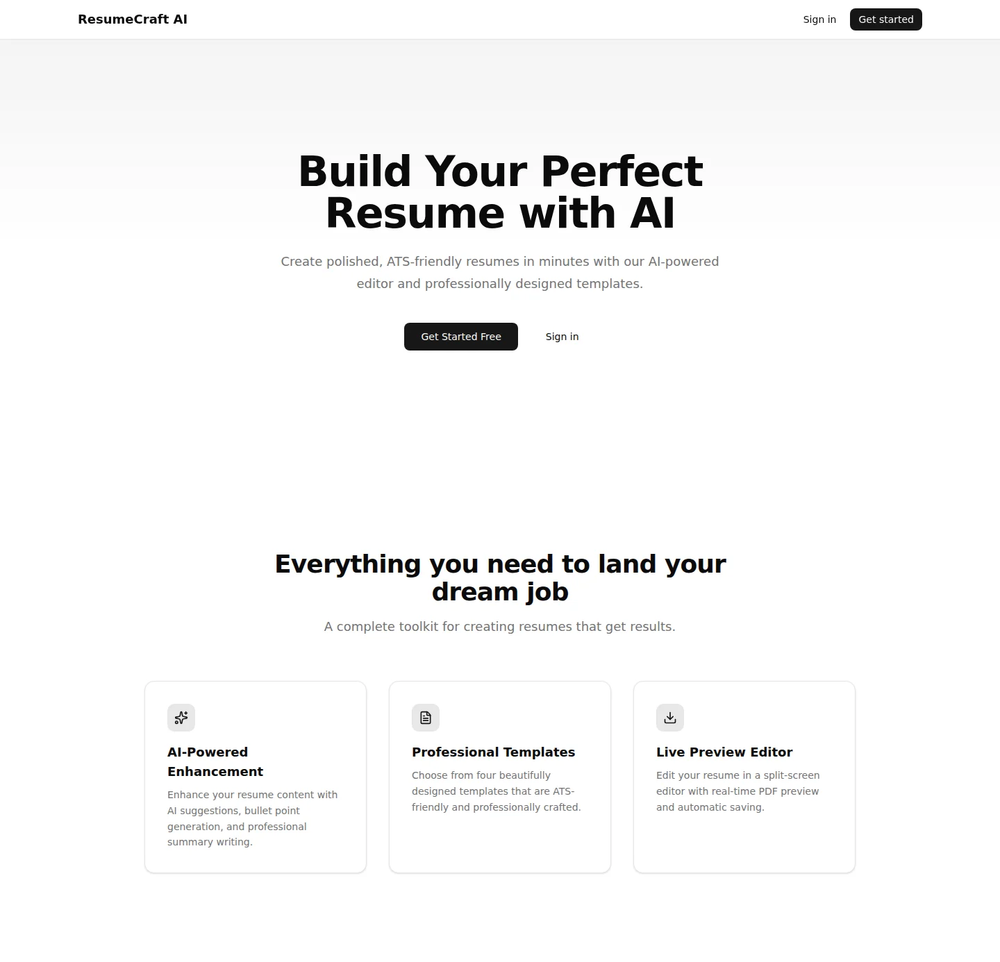
  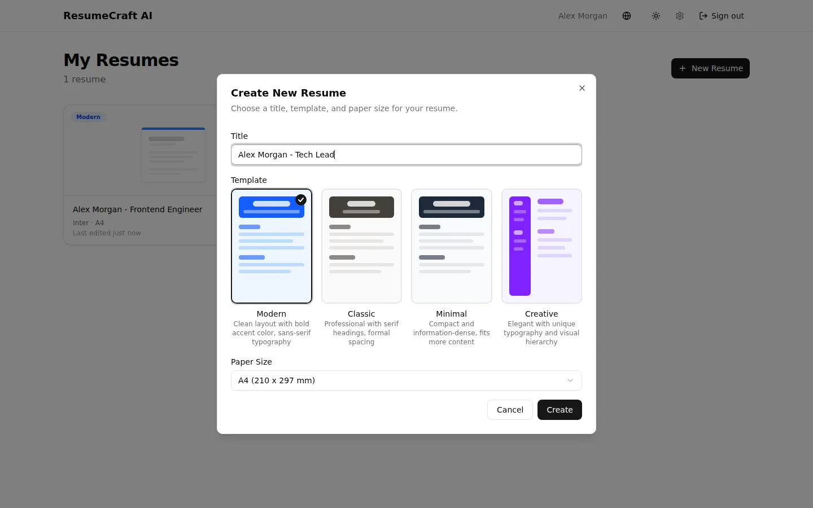

  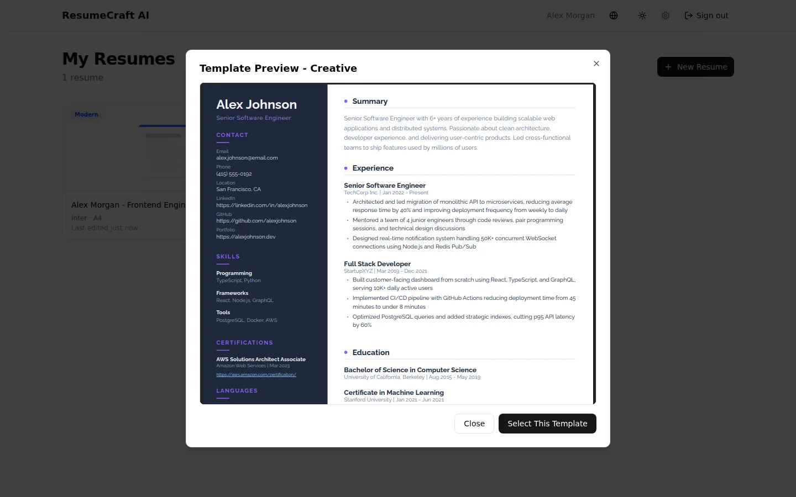
  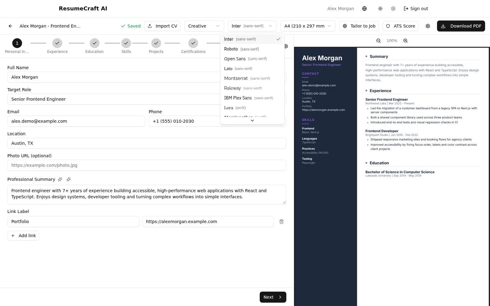

  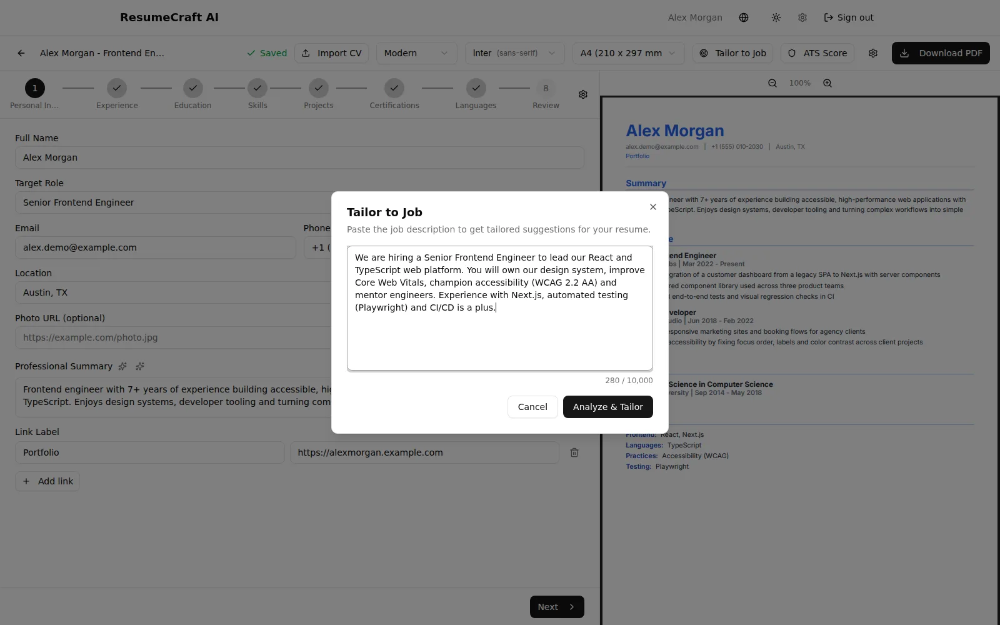
  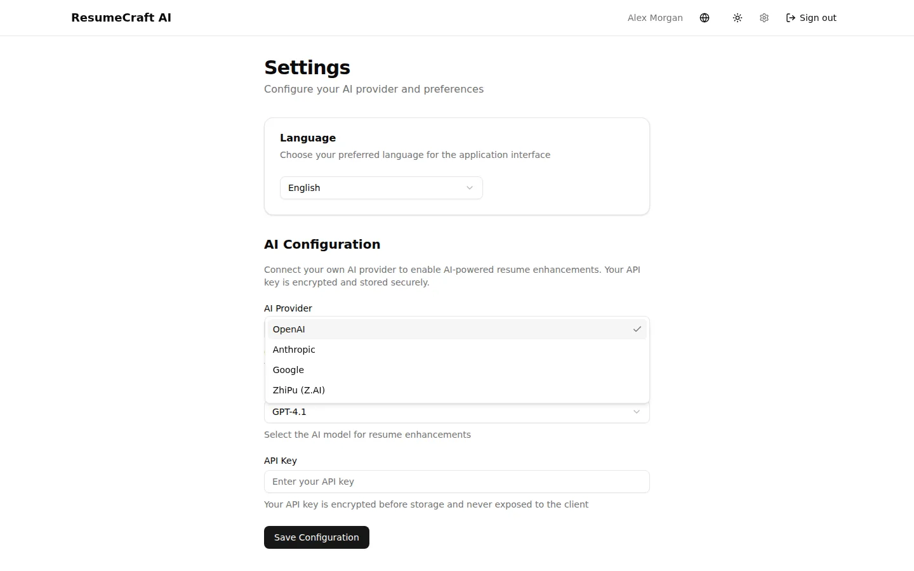

  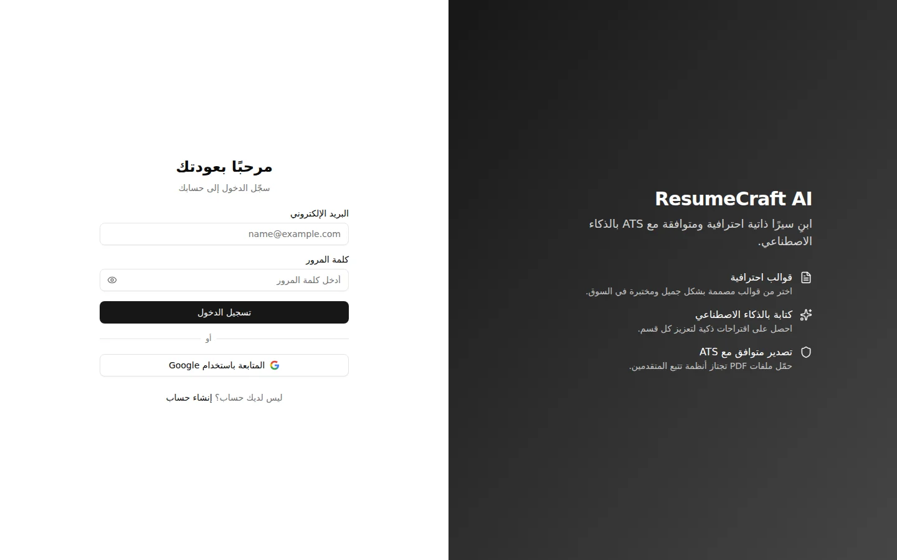
  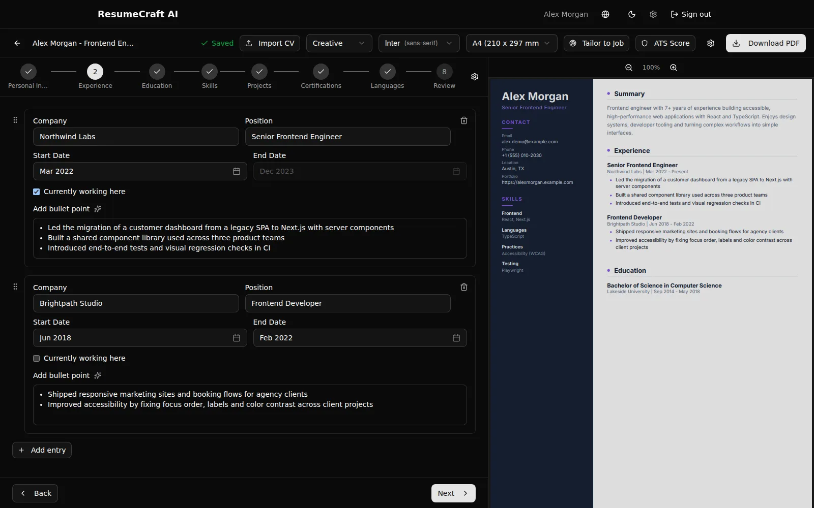

  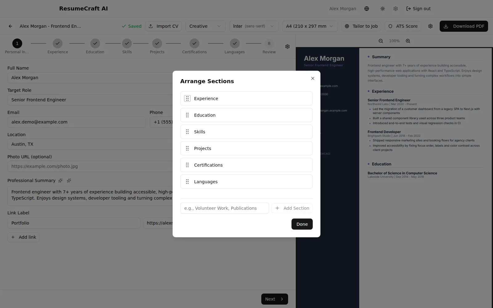
  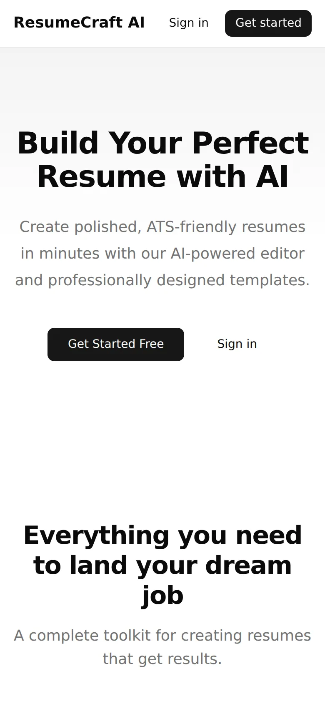

## Features

**Resume management**
- Email/password or Google sign-in; each user has their own dashboard of resumes.
- Create a resume with a title, one of four templates and a paper size (A4 or US Letter). Rename, duplicate and delete from the dashboard.

**Editor**
- Step-by-step wizard: Personal info, Experience, Education, Skills, Projects, Certifications, Languages, then a Review step. A progress bar lets you jump back to any step you've already reached.
- Split screen with a live PDF preview (zoom in and out) that redraws shortly after you stop typing.
- Rich-text bullet points (Tiptap) and month/year pickers with a "currently working here" option.
- Drag and drop to reorder sections and entries, plus custom sections such as "Volunteer Work".
- Switch template, font (12 ATS-friendly families) and paper size at any time; changes show up in the preview straight away.
- Changes save automatically, and a "Saved" indicator shows the current state. Export a PDF with one click.

**AI assistant (bring your own key)**
- Rewrite a field or the summary, with streamed output you can accept, reject or regenerate.
- Write a summary from your experience, write bullet points for a role, and get skill suggestions grouped by category.
- **Tailor to Job:** paste a job description to get a keyword analysis and suggestions per section. Apply them one at a time or all at once.
- **ATS Score:** an overall score plus four sub-scores (content quality, keyword match, formatting, section completeness), each with specific fixes.
- **Import CV:** upload a PDF, DOCX or TXT file and the AI fills in every editor section from it.
- Target-role autocomplete from a built-in list of 500+ job titles, with AI suggestions when the list has few matches.
- Works with OpenAI, Anthropic, Google Gemini or Z.AI (GLM). Each user picks a provider and model and adds their own API key in Settings.

**Language, theme and devices**
- English and Arabic interface with a full right-to-left layout.
- Arabic PDF output with translated section headings and an Arabic font (Amiri).
- AI answers in the user's interface language.
- Light and dark themes. On phones the editor gets a bottom action bar and a slide-up preview drawer.

## Architecture

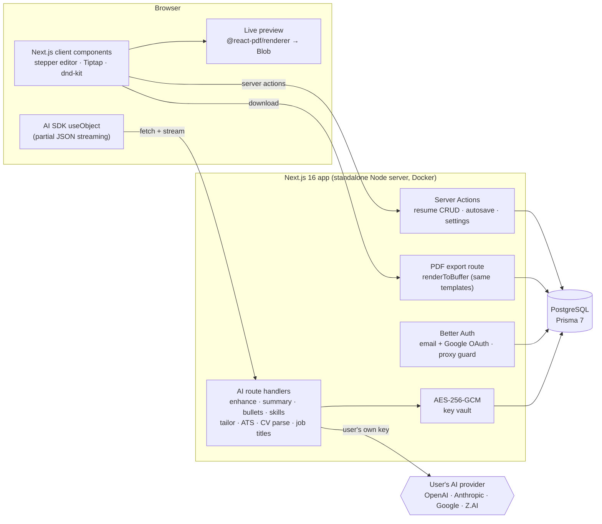

More detail (request flows, data model, deployment) is in [docs/architecture.md](docs/architecture.md).

### Key engineering decisions

- **Users bring their own AI key, and the server encrypts it.** A small provider registry builds an AI SDK model for the user's chosen provider (OpenAI, Anthropic, Google or Z.AI) on every request. Keys are encrypted at rest with AES-256-GCM (random IV plus auth tag) and stored per provider, so users can switch providers without entering keys again. Keys are decrypted only on the server and never sent back to the browser.
- **AI output is typed and streamed.** Tailoring, ATS scoring, bullets and skills use `streamText` with Zod object schemas. On the client, `useObject` renders the partial JSON as it arrives, so suggestions appear as they're generated rather than after a long wait. ATS scoring uses an explicit rubric at low temperature (0.2) so results stay consistent between runs.
- **The preview and the export use the same templates.** The four templates are `@react-pdf/renderer` components. The browser renders them to a Blob for the live preview (debounced, lazy-loaded), and the export route renders the same component to a buffer on the server. The preview therefore matches the exported file. Fonts, including Arabic, are self-hosted TTFs registered with the PDF engine.
- **Resumes are validated JSON documents.** Resume content lives in one Postgres JSON column and is checked against a Zod schema on every save. Autosave is debounced (1.5 s) and reports saved, saving or unsaved status. Every resume query is scoped by both the resume ID and the signed-in user's ID.
- **Language is handled end to end.** next-intl reads the locale from a cookie, and the locale is also saved on the user profile. The `<html dir>` attribute follows the locale. PDF templates receive the locale to translate headings and lay out right to left. The AI writing and scoring prompts get an instruction to answer in the user's language.
- **CV import picks a path by file type.** PDFs go straight to the model as a file part. DOCX files are converted to text with mammoth first. All imports are parsed into the same schema as the editor, with new IDs added, a 10 MB size limit and an allowlist of file types.

## Tech stack

| Layer | Tech |
|---|---|
| Framework | Next.js 16 (App Router, Server Actions, standalone output), React 19, TypeScript |
| UI | Tailwind CSS 4, shadcn/ui (Radix), lucide icons, vaul drawers, sonner toasts, next-themes |
| Editor | Tiptap (rich-text bullets), dnd-kit (drag-and-drop), react-hook-form + Zod |
| PDF | @react-pdf/renderer (client preview and server export), self-hosted TTF fonts incl. Amiri for Arabic |
| AI | Vercel AI SDK v6 (`ai`, `@ai-sdk/react`), providers: OpenAI, Anthropic, Google Gemini, Z.AI (GLM) |
| Auth | Better Auth (email/password, Google OAuth, 7-day sessions with cookie cache) |
| Data | PostgreSQL, Prisma 7 (pg adapter) |
| i18n | next-intl (English, Arabic), RTL layout |
| Infra | Docker multi-stage build (Node 22 Alpine, non-root user), Docker Compose, nginx reverse proxy with HTTPS, GitHub Actions deploy over SSH |

## My role

Solo personal project. I came up with the product, designed it and built it end to end: data model, auth, editor, PDF templates, AI features, i18n/RTL, deployment and CI/CD.

- Built over 9 planned phases, with a written plan and summary for each: foundation and auth, dashboard, PDF templates, editor, AI features, i18n/RTL, UX polish (mobile and dark mode), the stepper editor and CV import.
- Git history: 141 commits between 20 and 25 February 2026. 134 are under my name. The other 7 were committed under a bot identity (Cortex Bot) tied to my GitHub account and cover the Docker/CI deployment, locale-aware AI output and job-title autocomplete.

## Status

- **Live:** [resume.everbuild.cloud](https://resume.everbuild.cloud). Sign up with an email address or Google.
- Built in February 2026. It deploys automatically on every push to `main` (GitHub Actions → Docker Compose on my VPS).
- The AI features need the user's own API key, added in Settings. Without a key, the editor, templates and PDF export still work in full.
- Free to use, with no payments.

---

© 2026 Dafallah Ibrahim. Screenshots and documentation only. Source code is private.

