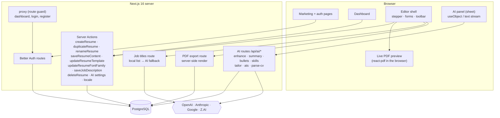
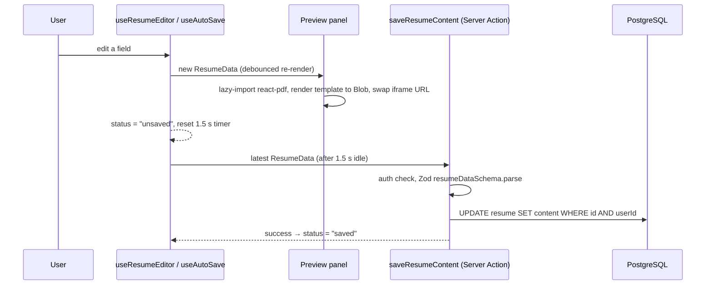
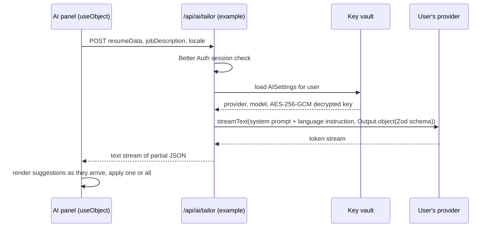
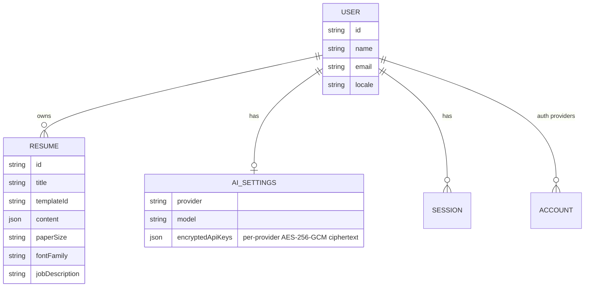
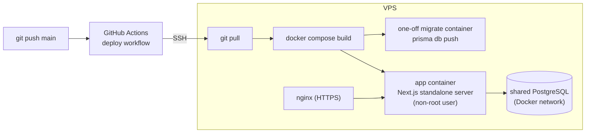

# ResumeCraft AI: architecture

This page goes deeper than the [README](../README.md). It covers how requests flow through the app, what is stored and how the app is shipped. Everything here comes from the private source code. Code is not reproduced.

## 1. System overview

ResumeCraft AI is a single Next.js 16 application (App Router) that serves the marketing page, the signed-in app and its API from one Node process. There is no separate backend. Reads and writes go through **Server Actions**, and AI and PDF work goes through **route handlers**.

## 2. Editing and autosave

- Editor state is one `ResumeData` object: personal info, experience, education, skills, projects, certifications, languages, custom sections and section order.
- The latest data is kept in a ref, so the debounced save always sends the newest version, and pending saves are cancelled when the editor unmounts.
- The preview revokes the previous Blob URL whenever it renders a new one, which avoids memory leaks during long sessions.

## 3. AI request flow

- **Provider registry.** It maps `openai | anthropic | google | zhipu` plus a model ID to an AI SDK model created with the user's own key. The models offered come from a typed config: GPT-4.1 family, Claude Sonnet/Haiku, Gemini 2.5 family and GLM-4.x.
- **Structured output.** Tailoring, ATS score, bullets and skills each have a Zod schema. Free-text features (enhance, summary) stream plain text.
- **Errors.** Routes return stable codes such as `UNAUTHORIZED`, `AI_NOT_CONFIGURED`, `UNSUPPORTED_FORMAT` and `PARSE_FAILED`. The UI turns these into translated messages. If no AI provider is configured, the AI panel shows a "Set up AI" prompt that links to Settings.
- **Locale.** The writing and scoring routes (enhance, summary, bullets, skills, tailor, ATS) add a language instruction to the system prompt, so Arabic users receive Arabic suggestions.
- **CV parsing.** PDFs are sent to the model as a file part. DOCX files are converted to text with mammoth, and plain-text files are passed through as they are. The result is post-processed: IDs are added to entries and a section order is derived from the sections that have content. Uploads are limited to 10 MB and an allowlist of file types.
- **Job-title autocomplete.** The server searches a local list first. It calls the user's AI provider only when there are fewer than five matches and the user is signed in with AI configured.

## 4. PDF generation

| | Live preview | Export |
|---|---|---|
| Where | Browser | Server route handler |
| How | `pdf(element).toBlob()` → iframe | `renderToBuffer(element)` → `application/pdf` attachment |
| Input | In-memory editor state | Stored resume JSON, user locale, paper size, font |
| Template | Same React component from the template registry | Same |

The four templates are Modern, Classic, Minimal and Creative. They support A4 and US Letter, 12 font families, custom sections, rich-text bullets and a locale prop that switches headings and direction for Arabic. The fonts are self-hosted TTF files (Inter, Roboto, Lora, EB Garamond, Amiri and others) registered with the PDF engine, so the output looks the same on every machine. `@react-pdf/renderer` is marked as an external server package, which keeps it out of the server bundle.

## 5. Data model

- When a user is deleted, their resumes, AI settings, sessions and accounts are deleted with them (cascading deletes).
- Resume content is stored as one validated JSON document. This keeps sections flexible (custom sections, ordering) and avoids a wide relational schema.

## 6. Auth and route protection

- Better Auth with the Prisma adapter supports email and password (8–128 characters) and Google OAuth. Sessions last 7 days, are refreshed daily and use a 5-minute cookie cache to reduce database reads.
- A Next.js `proxy` guards `/dashboard`, `/login` and `/register`: signed-out users are redirected to log in, and signed-in users are redirected away from the auth pages. Server Actions and route handlers check the session again themselves.

## 7. Internationalisation

- next-intl loads `en` or `ar` messages based on a `locale` cookie. When the user changes language, the choice is also saved on their profile.
- The root layout sets `lang` and `dir` from the locale. Components use logical CSS properties (start/end), so the RTL layout works without separate stylesheets.

## 8. Build and deployment

- Multi-stage Dockerfile on Node 22 Alpine. The builder stage generates the Prisma client and runs `next build` with `output: "standalone"`. The runtime stage copies only the standalone server, static and public assets, the Prisma schema and the generated client, and runs as an unprivileged user.
- The app container listens only on the loopback interface and is published through nginx with TLS.
- Old Docker images are pruned after each deploy.
